# VCF Logs Migrator

VCF Logs Migrator is an independent community tool. It isn't a Broadcom product and Broadcom doesn't support it. The log data transfer built into VCF Operations covers 90 days of logs. This tool uses the same APIs, but you can move as much history as you want and have the patience for.

It moves logs from Aria Operations for Logs 8.18.x to VCF Operations for Logs 9.0.x (9.1.1 is a preview). It copies closed groups of logs for the destination to ingest. You can compare event counts afterward. A finished transfer doesn't prove every event arrived, so look at the checks.

## Download

Each download has both a desktop window and a command-line interface (CLI). You don't need Python.

| Platform | Download | Open the window | Run the CLI |
|---|---|---|---|
| Windows x64 | `vcf-logs-migrator-vX.Y.Z-windows-x64.exe` | Double-click the executable | `vcf-logs-migrator-vX.Y.Z-windows-x64.exe <command>` |
| macOS Apple silicon | `vcf-logs-migrator-vX.Y.Z-macos-arm64.dmg` | Open the disk image and drag the app to Applications | `/Applications/VCF Logs Migrator.app/Contents/MacOS/logs-migrate <command>` |
| Linux x86_64, glibc 2.35+ | `vcf-logs-migrator-vX.Y.Z-linux-x86_64` | Make executable, then run with `gui` | Run the executable with a command |

[GitHub Releases](https://github.com/sentania-labs/vcf-logs-migrator/releases) also has `SHA256SUMS` and `THIRD-PARTY-NOTICES.txt`. To see the bundled notices, use `--licenses` or About → Licenses. On Linux, the window needs a desktop session and the Qt system libraries (libEGL/libGL, fontconfig, libxkbcommon-x11 and libxcb-cursor0).

## Before you start

- On the source, you need the address of one 8.18 cluster member, a Logs API account and password, and root SSH access to **every** 8.18 member. Your workstation has to reach the source Logs API on port 9543 and each source member over SSH on port 22. The destination needs SSH access to each source member too.
- On the destination, you need the Logs address, an API account and password, and access to port 9543. If you also give it root SSH access, the plan can check free storage on each destination node.
- During the copy, the source root SSH password goes to the destination so it can pull the data. Type passwords at a prompt or in the window. For automation, use the private credential methods in the [lab guide](docs/testing-against-a-lab.md), and never put a password in a command argument.
- Compare the certificate and SSH host key fingerprints with the appliances before you trust them. The command line asks about every one. The window asks once, before any password is sent, about the two addresses you typed and the server at each. If signing in finds more servers behind an address, it asks once more about those before any password goes to them. It stops if a recorded identity ever changes. Make sure the partition configuration matches and the destination has enough space. The [lab guide](docs/testing-against-a-lab.md) is a step-by-step walkthrough against lab appliances, with the exact commands for these checks.

## Walk through a migration with the CLI

This example uses a 9.0 destination and a two-day UTC interval. Swap in your own addresses and dates. The end date is exclusive, so the example covers March 19 and 20.

Open a terminal on the machine where you downloaded the tool. On every line below, replace `logs-migrate` with the command for your platform:

- **macOS:** use the full command from the download table.
- **Linux:** use `./vcf-logs-migrator-vX.Y.Z-linux-x86_64`, after running `chmod +x` on the download.
- **Windows PowerShell:** use `./vcf-logs-migrator-vX.Y.Z-windows-x64.exe`.

It asks for passwords when it needs them.

Set the addresses once in your terminal so every command picks them up. On macOS or Linux:

```sh
export LOGS_SOURCE=source.example.com LOGS_DESTINATION=destination.example.com
```

In Windows PowerShell:

```powershell
$env:LOGS_SOURCE = "source.example.com"
$env:LOGS_DESTINATION = "destination.example.com"
```

The API user defaults to `admin` and the source SSH user to `root`. The [lab guide](docs/testing-against-a-lab.md#what-you-need) covers other usernames and credential options. Every command below uses the same private run file. It records what you selected and what the tool saw on this destination, so keep it somewhere safe for later runs.

1. **Trust and test.** Start by recording the appliances' identities. This sends no credentials. Compare the fingerprints it prints with the appliances before you go on. If it finds more cluster members later, run this step again.

   ```text
   logs-migrate --trust-new selftest
   Unknown appliance identity: TLS <source>:9543 SHA256 <fingerprint>
   Enrolled (--trust-new); no credential is sent on this run.
   ...
   {"enrolled": [...], "credentials_sent": false, "next": "Verify each fingerprint ..."}
   ```

   Once the identities are trusted, run the read-only checks:

   ```text
   logs-migrate selftest
   PASS  Source API version                  8.18.7
   ...
   PASS  Destination API version             9.0.2.0200
   ...
   Summary: 17 passed, 0 failed, 0 skipped. All checks passed.
   Read-only: nothing was started, written or stopped.
   ```

2. **Plan.** Pick a private path for `migration.sqlite` and stick with it. Read through the selected groups, the skipped open groups, partition differences, capacity and warnings before you continue. The output below is trimmed from an evaluation, with identifiers masked, so yours will look different.

   ```text
   logs-migrate --journal migration.sqlite plan --since 2024-03-19T00:00:00Z --until 2024-03-21T00:00:00Z
   {
     "id": "<run-id>",
     "plan": {
       "selected": [ ... 5 groups ... ],
       "active_skipped": [ ... 18 open groups ... ],
       "partial_days": [ ... ],
       "capacity": { ... }, "partition_diff": { ... }, "warnings": [ ... ]
     }, ...
   }
   ```

   **Sizing a migration.** A reference 3-node 8.18 to 3-node 9.0 migration over 1 GbE
   copied 1,037 buckets (393 GB) in 8 hours 42 minutes, about 12.6 MB/s overall. Storage
   load and the number of buckets affect the rate, so start with a small window and
   extrapolate from your own run. The preview gives a rough range and its assumptions;
   a rate measured for several minutes on the same cluster pair improves later previews.

   Take the `id` from your plan and use it in place of `<run-id>` below. If the partitions differ, sort that out before copying. See [configuration rules](docs/operator-cli.md#configuration-rules).

3. **Copy.** Once you've read the plan, start the transfer. If the plan leaves out open groups, you have to acknowledge that their data won't be copied. Keep the quotes exactly as shown.

   ```text
   logs-migrate --journal migration.sqlite copy <run-id> --ack-active "i understand you aren't going to copy the latest data"
   {"run_id": "<run-id>", "task": {"id": "<task-id>", "status": "running", "progress": 0.0, ...}, ...}
   ```

4. **Watch, verify and report.** Run `status` until the task finishes, then run `verify` and `report`. The report comes out as Markdown, so redirect it to a private file if you want to keep it. A completed task can still have skipped data, so look closely at the verification and any partial days. If a transfer stops or fails partway, `resume <run-id>` finishes only what did not arrive; see [finishing a stopped transfer](docs/operator-cli.md).

   ```text
   logs-migrate --journal migration.sqlite status
   {"id": "<task-id>", "status": "completed", "progress": 100.0, "elapsed_seconds": 146.06, ...}

   logs-migrate --journal migration.sqlite verify <run-id>
   {"complete": true, "expected_count": 342837, "measured_arrival_count": 24286, "partial_days": [...], ...}

   logs-migrate --journal migration.sqlite report <run-id>
   # Migration count report
   ...
   5 selected groups; 342,837 events sent from selected groups; arrivals were counted for the requested dates only (... 24,286 arrived); 71 other days these groups touch were not counted; ... 1 fully matched days; 1 partial days.
   ```

The example report counts whole selected groups on the source, but only the requested dates on the destination. Those totals cover different date ranges. The [CLI operator guide](docs/operator-cli.md) explains incomplete checks, errors and reports. For a longer walkthrough against lab appliances, see [Testing against a lab](docs/testing-against-a-lab.md).

## Use the window

Open the download as shown above. The window is five steps down the left side, done in order: **Connect, Copy rules, Choose dates, Copy logs, Check result.** A step you can't do yet is greyed out and says why. Every screen has one main button, bottom right, with a sentence beside it saying what happens next. These pictures come from stand-in systems, not a real environment.

1. **Connect.** Type each system's address and admin sign-in, the source servers' root password and (recommended) the destination servers' root password, then press **Test connections**. The first time, before any password is sent, the app asks whether these two addresses are the systems you meant. It shows each certificate's fingerprint and the identity code of the server at each address, for comparing. If a system has several servers, one more question lists the others, and none of them is sent a password until you have confirmed it. You then see whether these two systems can migrate, and if not, which one has to change.

   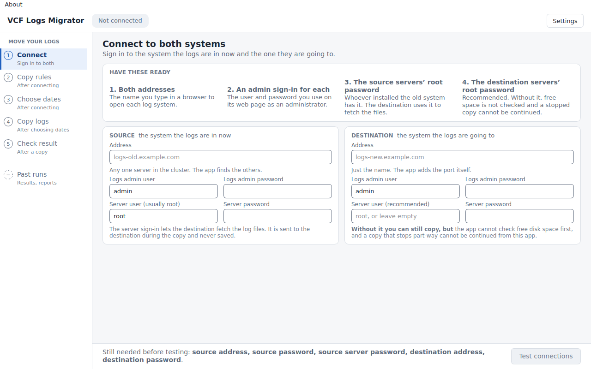
   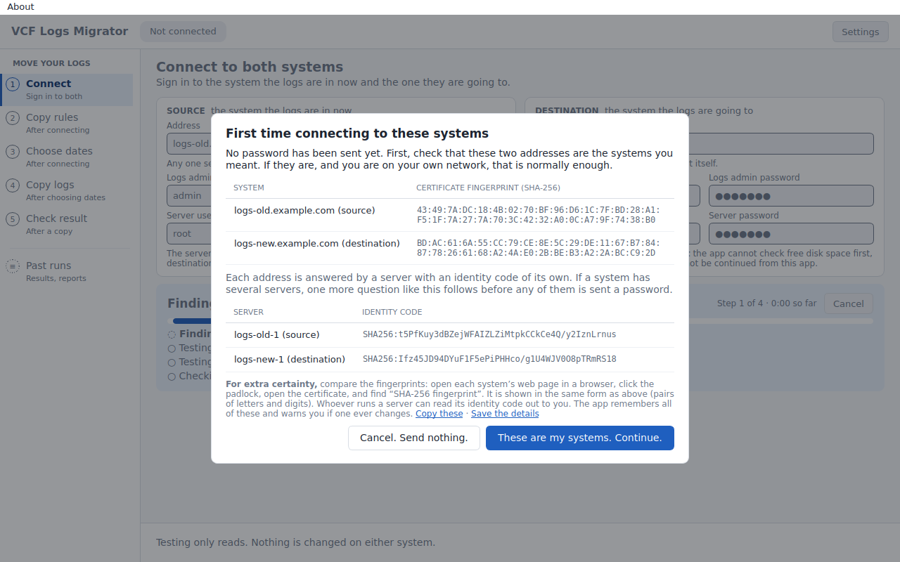
   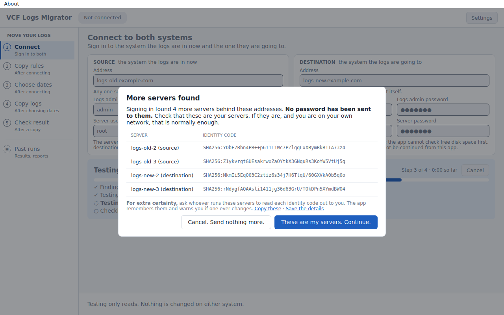
   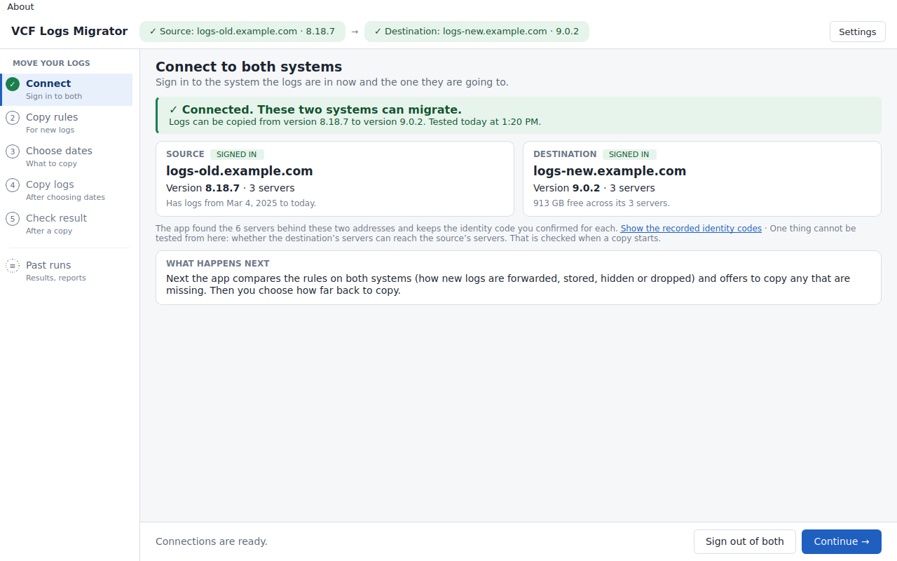

2. **Copy rules.** The app compares the rules on both systems by itself and lists the ones that are missing or different, in plain words. A rule the copy depends on is marked **Needed**. Untick what you don't want, confirm once, and each rule is shown as copied.

   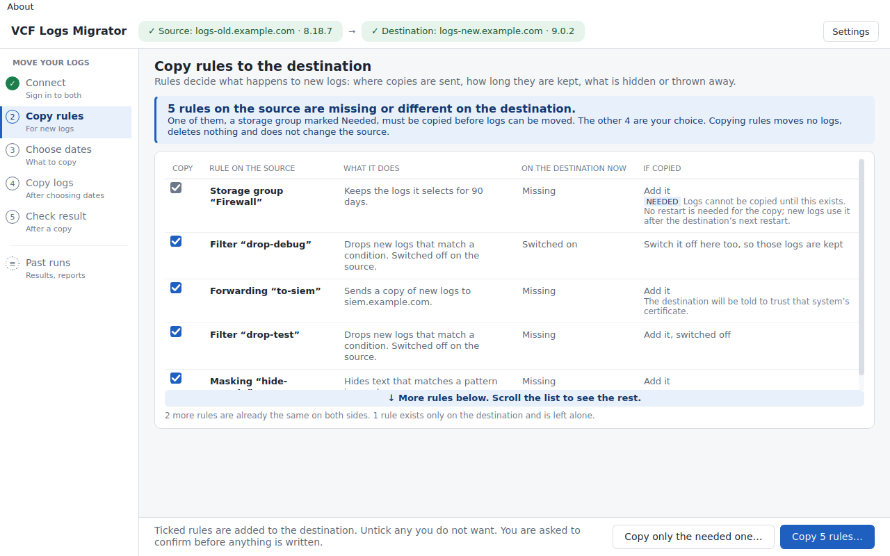

3. **Choose dates.** Pick how far back and press **Check these dates**. The plan is a short list: what is copied, how big, how long, whether it fits, and what is left out. Tick the box beside **Start copying** to start. If the dates can't be copied as picked, the screen says which days are affected and why, and the button fixes it.

   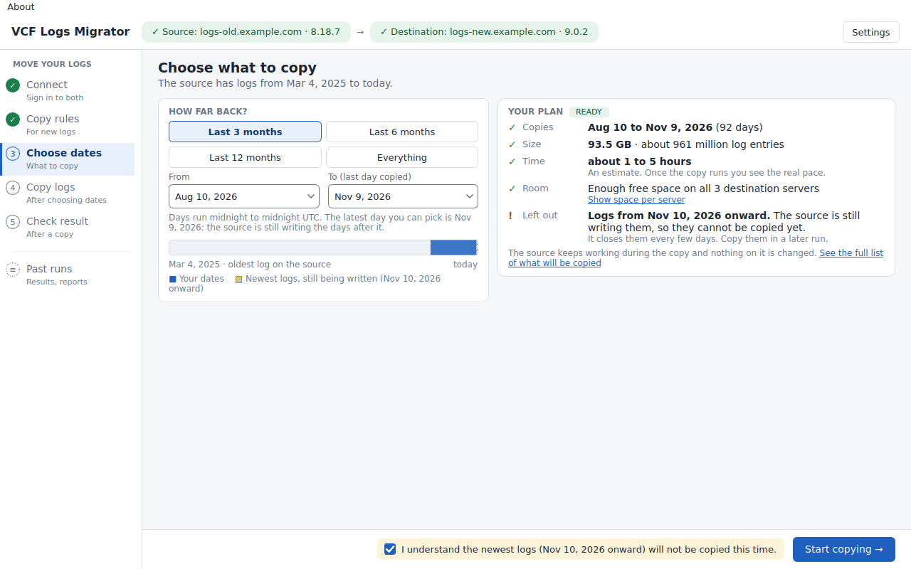
   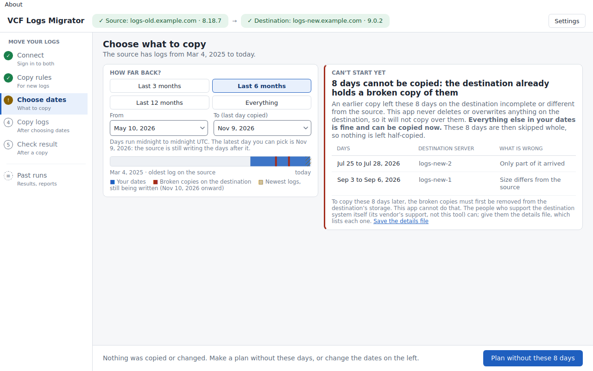

4. **Copy logs.** One percentage, a bar, time left and a row per destination server. You can close the window; the copy runs on the destination. **Stop the copy…** asks first, and **Continue copying** sends only what is missing.

   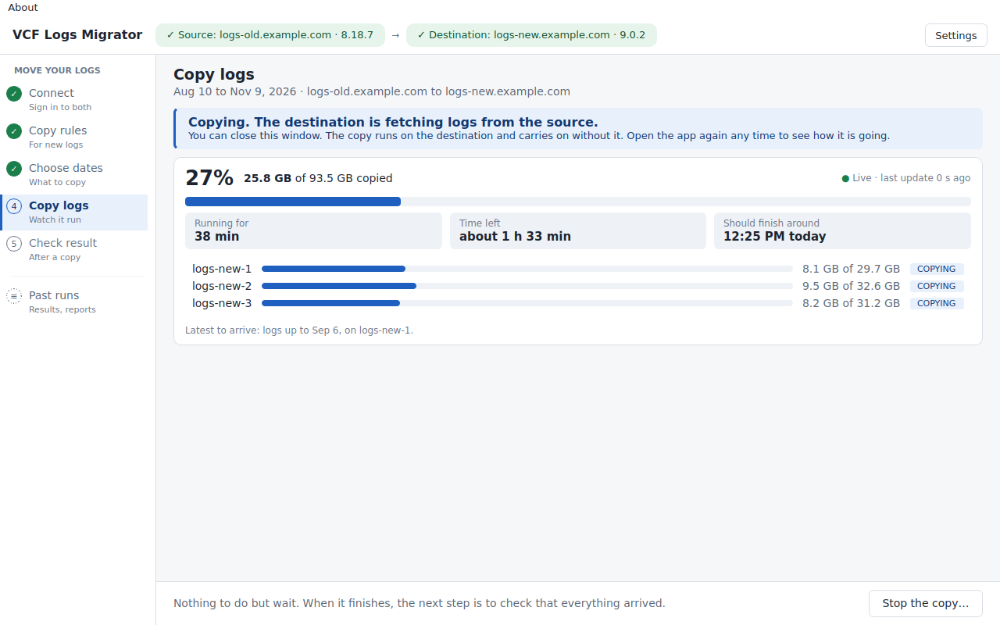
   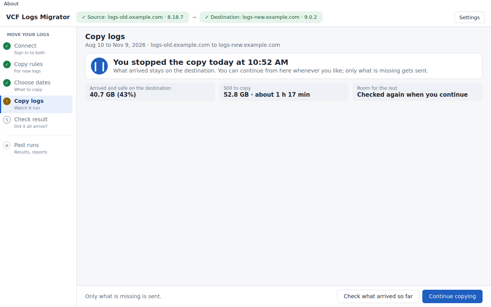

5. **Check result.** The app counts both systems day by day and gives one verdict, then only the days that differ and what each means. **Save report** writes a readable report and a data file.

   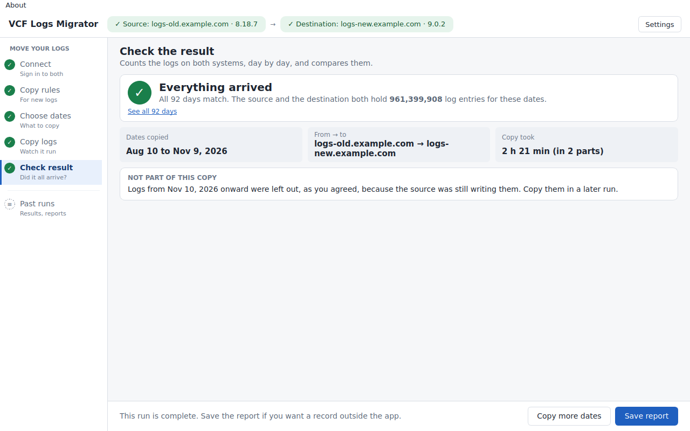
   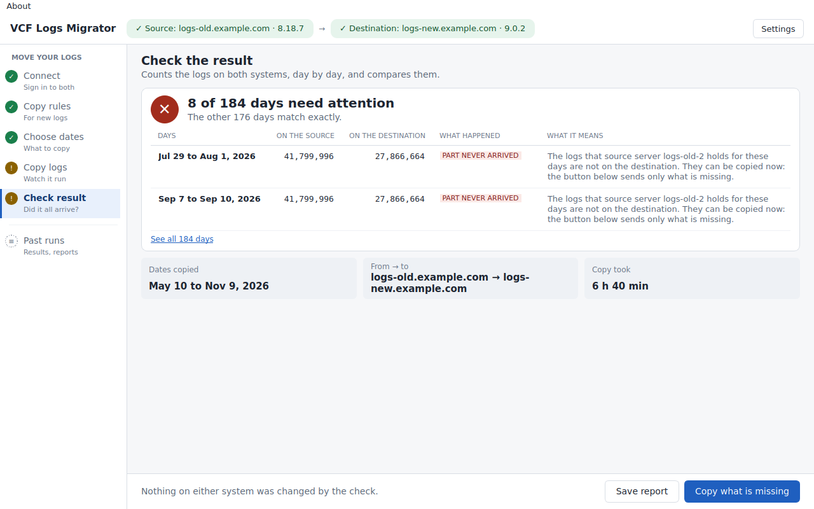

**Past runs** lists every copy you started and opens without signing in. **Settings** holds colours, the time zone, where reports are saved and one **Save troubleshooting file** button.

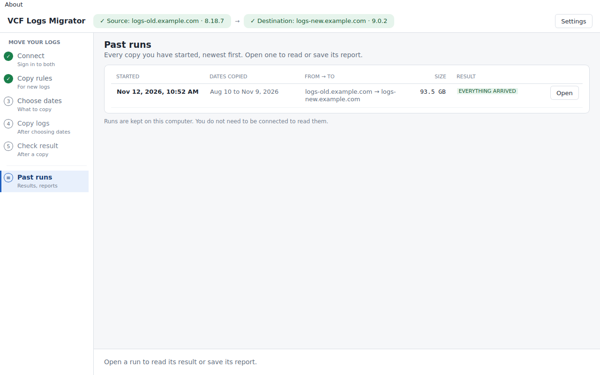

## What to expect

- A bucket is a group of logs stored by the source. The tool copies whole closed buckets, so coverage can run past the dates you asked for. Open buckets are skipped, so you may need another run once they close to pick up the newest data. Some open data may never close, so keep the source around according to your retention plan.
- A day is partial when some of its logs are in open or unselected buckets. Its counts can differ, so check those days. On 9.0, migrated events land in the destination's Default partition. Matching counts don't show that event contents or partition placement match.
- Plan on minutes per step against a large source. In one evaluation with about 4,300 source buckets, planning took 206 seconds and starting the transfer took 200 seconds. The transfer itself took about 146 seconds and verification took 117 seconds. Your times will depend on inventory, data, network and appliance load.
- The tool never stops or writes to the source. It never deletes source buckets or anything on the destination, and copying only adds data. The destination applies its own retention and disk limits, so check free space first.
- You can compare and copy forwarding, partition, masking and filter rules separately with `config compare` and `config apply`, or on the window's **Copy rules** step. Only the rules you select are applied, and each one overwrites any destination rule with the same name. See [configuration rules](docs/operator-cli.md#configuration-rules).
- 9.1.1 support is a preview, and count verification isn't available for that destination. Read the [9.1.1 notes](docs/testing-against-a-lab.md#911-preview) before you use it.

For troubleshooting, see [operator troubleshooting](docs/operator-cli.md#troubleshooting-logs). Detailed logs can contain appliance addresses, so check them before you share them.

---

## Building and development

`packaging/build.py` uses pinned PyInstaller tools and Python 3.12.10. Builds run natively on GitHub-hosted Linux, Windows and macOS runners, with smoke tests for the CLI and window. Windows downloads are Authenticode signed, macOS downloads are signed and notarized, and Linux downloads come with checksums.

To build locally, install the dependencies with `python -m pip install -r packaging/requirements.txt '.[ssh]'`, then run `python packaging/build.py build <platform>` and `python packaging/build.py package <platform>`. To test the result, run `python packaging/smoke.py dist/<download>`.

For development, install Python 3.11+ and run `python -m pip install '.[dev,gui,ssh]'`, then `make check` and `make smoke`. GUI tests use Qt's offscreen platform and skip if PySide6 isn't installed. SSH tests skip if Paramiko isn't installed. `python tests/gui_screenshots.py --output DIR` walks every screen and state against stand-in systems, saves a picture of each and fails if any screen would need page scrolling. `python tests/standin.py --output DIR` writes stand-in systems you can open the window on by hand.

## Research and historical evidence

| Document | Evidence |
|---|---|
| [Official API validation](docs/validation-2026-11-06-official-api.md) | 9.0/9.1.1 requests, placement, dedupe, disk skips, active exclusions, partition behavior |
| [Partitions and multi-node validation](docs/validation-2026-11-06-partitions-multinode.md) | Partition registration, creation time, three-node source and target experiments |
| [Validation run](docs/validation-2026-11-06.md) | Date selection, populated targets, retention and interrupted manual transfers |
| [Lab runs](docs/lab-runs.md) | Historical experiments, including the manual 2,429,018-event run |
| [Research guide](docs/research-guide.md) | Original investigation and experimental procedures |
| [Config migration](docs/config-migration.md) | Config API findings; broader config migration is outside this delivery |
| [Specification](docs/spec.md) | Product design and historical appendix; the operator guide describes shipped commands |
| [Testing against a lab](docs/testing-against-a-lab.md) | Step-by-step for real hosts |

The files under `scripts/` are old research prototypes, and the CLI doesn't use them. Some stop the source, use insecure transport or delete data, so don't follow them as production instructions.

MIT licensed. Passing simulator tests and lab checks doesn't mean the tool is ready for your production environment.
