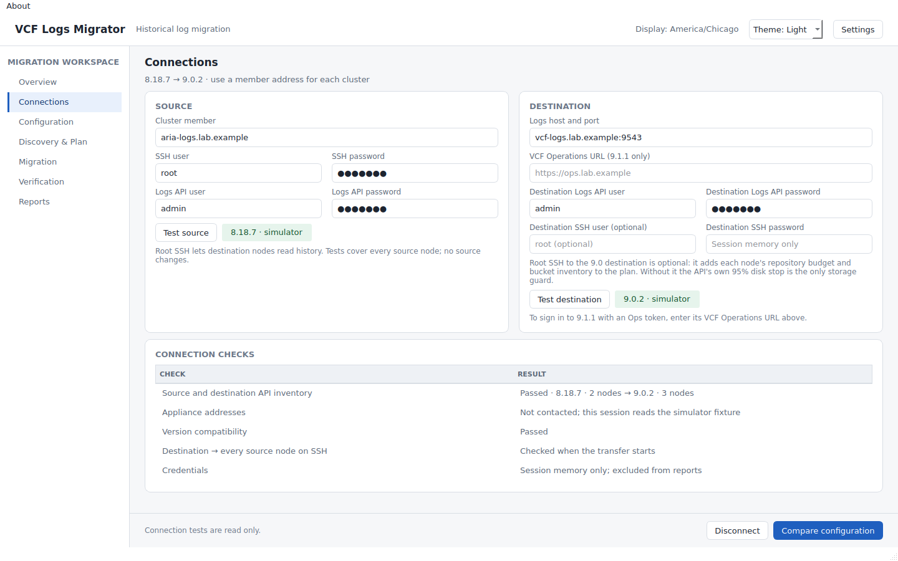
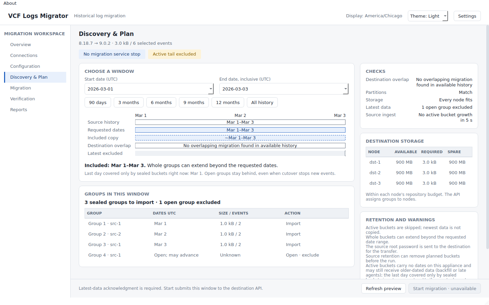
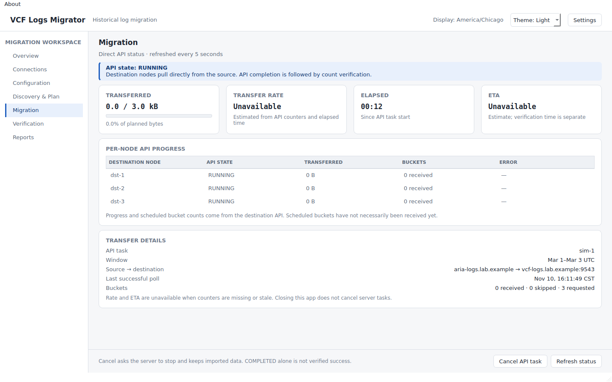
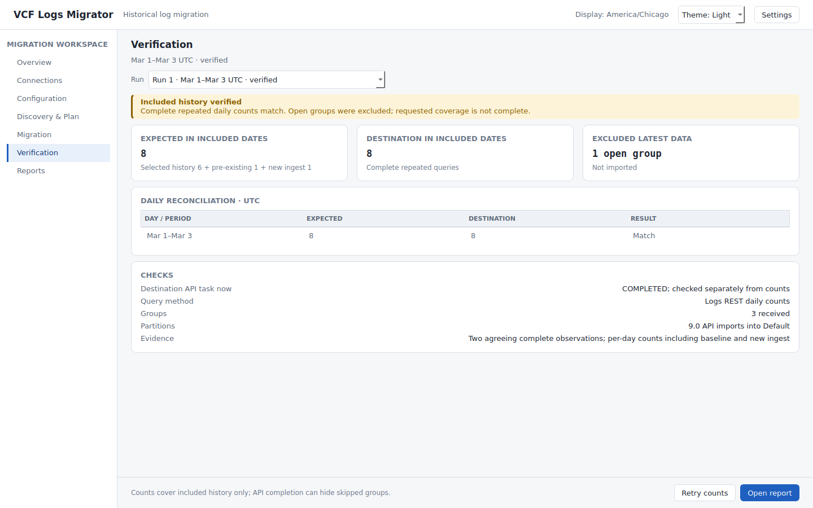
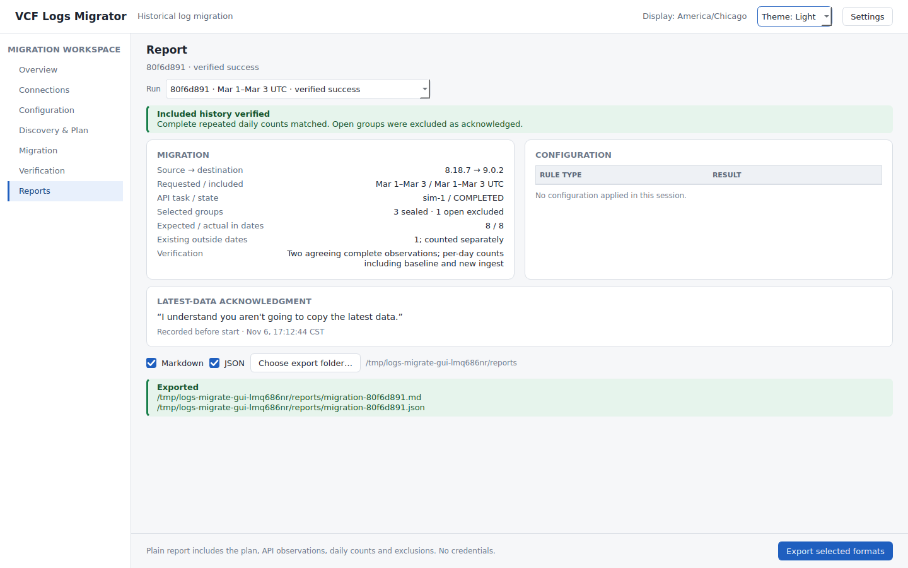

# VCF Logs Migrator

VCF Logs Migrator is an independent community tool. It is not a Broadcom product and is not supported by Broadcom. VCF Operations' built-in log data transfer supports 90 days of logs. This tool uses the same APIs and lets you move as much history as you want and have the patience for.

It moves logs from Aria Operations for Logs 8.18.x to VCF Operations for Logs 9.0.x (9.1.1 is a preview). It copies closed groups of logs and checks event counts. A completed transfer alone does not prove every event arrived.

## Download

Each download includes a desktop window and a command-line interface (CLI). You do not need Python.

| Platform | Download | Open the window | Run the CLI |
|---|---|---|---|
| Windows x64 | `vcf-logs-migrator-vX.Y.Z-windows-x64.exe` | Double-click the executable | `vcf-logs-migrator-vX.Y.Z-windows-x64.exe <command>` |
| macOS Apple silicon | `vcf-logs-migrator-vX.Y.Z-macos-arm64.dmg` | Open the disk image and drag the app to Applications | `/Applications/VCF Logs Migrator.app/Contents/MacOS/logs-migrate <command>` |
| Linux x86_64, glibc 2.35+ | `vcf-logs-migrator-vX.Y.Z-linux-x86_64` | Make executable, then run with `gui` | Run the executable with a command |

[GitHub Releases](https://github.com/sentania-labs/vcf-logs-migrator/releases) also provides `SHA256SUMS` and `THIRD-PARTY-NOTICES.txt`. Use `--licenses` or About → Licenses to see bundled notices. On Linux, the window needs a desktop session and Qt system libraries (libEGL/libGL, fontconfig, libxkbcommon-x11 and libxcb-cursor0).

## Before you start

- Copying only adds data to the destination and has no undo. Decide beforehand how you would recover.
- You need an 8.18 cluster member address, a Logs API account and password, and root SSH access to **every** 8.18 member. Your workstation must be able to reach the source Logs API on port 9543 and each source member over SSH on port 22. The destination also needs SSH access to each source member.
- You need the destination Logs address, an API account and password, and access to port 9543. You can also provide destination root SSH access so the plan can check available storage on each destination node.
- During copy, the source root SSH password is sent to the destination so it can pull the data. Enter passwords at a prompt or in the window. For automation, use the private credential methods in the [lab guide](docs/testing-against-a-lab.md). Never put passwords in command arguments.
- Check certificate and SSH host key fingerprints against the appliances before trusting them. Check that partition configuration matches and the destination has enough space. See the [lab guide](docs/testing-against-a-lab.md) for the full checklist and commands.

## Walk through a migration with the CLI

This example uses a 9.0 destination and a two-day UTC interval. Use your own addresses and dates. The end date is exclusive: the example covers March 19 and 20.

Open a terminal on the machine where you downloaded the tool. Replace `logs-migrate` on every line below with the command for your platform:

- **macOS:** use the full command from the download table.
- **Linux:** use `./vcf-logs-migrator-vX.Y.Z-linux-x86_64`. First run `chmod +x` on the download.
- **Windows PowerShell:** use `./vcf-logs-migrator-vX.Y.Z-windows-x64.exe`.

The tool prompts for passwords when it needs them.

Set the addresses once in your terminal so each command uses them. On macOS or Linux:

```sh
export LOGS_SOURCE=source.example.com LOGS_DESTINATION=destination.example.com
```

In Windows PowerShell:

```powershell
$env:LOGS_SOURCE = "source.example.com"
$env:LOGS_DESTINATION = "destination.example.com"
```

The default API user is `admin` and the default source SSH user is `root`. See the [lab guide](docs/testing-against-a-lab.md#what-you-need) for other usernames and credential options. Use the same private run file for every command below. It records what you selected and what the tool observed for this destination. Keep it safe for later runs.

1. **Trust and test.** First, record the appliances' identities. This command sends no credentials. Compare the printed fingerprints with the appliances before continuing. Repeat this step if the tool discovers more cluster members.

   ```text
   logs-migrate --trust-new selftest
   Unknown appliance identity: TLS <source>:9543 SHA256 <fingerprint>
   Enrolled (--trust-new); no credential is sent on this run.
   ...
   {"enrolled": [...], "credentials_sent": false, "next": "Verify each fingerprint ..."}
   ```

   Run the read-only checks after the identities are trusted:

   ```text
   logs-migrate selftest
   PASS  Source API version                  8.18.7
   ...
   PASS  Destination API version             9.0.2.0200
   ...
   Summary: 17 passed, 0 failed, 0 skipped. All checks passed.
   Read-only: nothing was started, written or stopped.
   ```

2. **Plan.** Choose a private path for `migration.sqlite` and use it throughout. Review selected groups, skipped open groups, partition differences, capacity and warnings before continuing. The output below is shortened from an evaluation, with identifiers masked. Your results will differ.

   ```text
   logs-migrate --journal migration.sqlite plan --since 2024-03-19T00:00:00Z --until 2024-03-21T00:00:00Z
   {
     "id": "<run-id>",
     "plan": {
       "selected": [ ... 5 groups ... ],
       "active_skipped": [ ... 18 open groups ... ],
       "partial_days": [ ... ],
       "capacity": { ... }, "partition_diff": { ... }, "warnings": [ ... ]
     }, ...
   }
   ```

   Copy the actual `id` from your plan and replace `<run-id>` below. If partitions differ, resolve the differences before copying. See [configuration rules](docs/operator-cli.md#configuration-rules).

3. **Copy.** After deciding how you would recover and reviewing the plan, start the transfer. `--ack-backup` records your acknowledgment before a transfer with no undo. If the plan excludes open groups, you must also acknowledge that their data will not be copied. Keep the quotes exactly as shown.

   ```text
   logs-migrate --journal migration.sqlite copy <run-id> --ack-backup --ack-active "i understand you aren't going to copy the latest data"
   {"run_id": "<run-id>", "task": {"id": "<task-id>", "status": "running", "progress": 0.0, ...}, ...}
   ```

4. **Watch, verify and report.** Repeat `status` until the task finishes, then run `verify` and `report`. The tool prints the report as Markdown. Redirect it to a private file if you want to keep it. A completed task can still have skipped data, so inspect the verification and any partial days.

   ```text
   logs-migrate --journal migration.sqlite status
   {"id": "<task-id>", "status": "completed", "progress": 100.0, "elapsed_seconds": 146.06, ...}

   logs-migrate --journal migration.sqlite verify <run-id>
   {"complete": true, "expected_count": 342837, "measured_arrival_count": 24286, "partial_days": [...], ...}

   logs-migrate --journal migration.sqlite report <run-id>
   # Migration count report
   ...
   5 selected groups; 342,837 events sent from selected groups; arrivals were counted for the requested dates only (... 24,286 arrived); 71 other days these groups touch were not counted; ... 1 fully matched days; 1 partial days.
   ```

The example report compares whole selected groups with a narrower requested date window. Counts are evidence, not proof of identical event content. The [CLI operator guide](docs/operator-cli.md) explains incomplete checks, errors, and reports. For a detailed walkthrough on real appliances, see [Testing against a lab](docs/testing-against-a-lab.md).

## Use the window

Open the download as shown above. These pictures use the simulator, not a real environment.

1. On **Connections**, enter the source and destination addresses and credentials. Test the connection and compare each trust prompt's fingerprint with the appliance. Run the self-test and review its results.

   

2. On **Discovery & Plan**, choose the dates and preview the plan. Review the selected and excluded groups, capacity, partitions and warnings. Decide how you would recover and acknowledge that there is no undo before starting.

   

3. Watch the **Migration** page until the destination reports completion.

   

4. Run the checks on **Verification** and examine partial days and any missing evidence.

   

5. Open **Reports** and export the results for your records.

   

## What to expect

- A bucket is a group of logs stored by the source. The tool selects whole closed buckets, so the actual coverage can extend beyond the requested dates. Open buckets are skipped. You may need another run after they close to pick up the newest data. Some open data may never close, so keep the source according to your retention plan.
- Days shared with open or unselected buckets are partial. Their counts can differ and need review. On 9.0, migrated events land in the destination's Default partition. Matching counts do not prove that the event contents or partition placement match.
- Allow minutes for each step on a large source. In one evaluation with about 4,300 source buckets, planning took 206 seconds and starting the transfer took 200 seconds. The transfer itself took about 146 seconds, and verification took 117 seconds. Your times depend on inventory, data, network and appliance load.
- The tool never stops the source or writes to it. It never deletes source buckets or anything on the destination. Copying only adds data. The destination applies its own retention and disk limits, so check available space first.
- Forwarding, partition, masking and filter rules can be compared and copied separately with `config compare` and `config apply`, or on the window's **Configuration** page. Only the rules you select are applied. Each selected rule overwrites any destination rule with the same name. See [configuration rules](docs/operator-cli.md#configuration-rules).
- 9.1.1 support is a preview. Count verification is not available for that destination. See the [9.1.1 notes](docs/testing-against-a-lab.md#911-preview) before using it.

For troubleshooting, see [operator troubleshooting](docs/operator-cli.md#troubleshooting-logs). Detailed logs can contain appliance addresses, so review them before sharing.

---

## Building and development

`packaging/build.py` uses pinned PyInstaller tools and Python 3.12.10. Builds run natively on GitHub-hosted Linux, Windows and macOS runners, with smoke tests for the CLI and window. Windows downloads are Authenticode signed. macOS downloads are signed and notarized. Linux downloads have checksums.

To build locally, install the dependencies with `python -m pip install -r packaging/requirements.txt '.[ssh]'`, then run `python packaging/build.py build <platform>` and `python packaging/build.py package <platform>`. Run `python packaging/smoke.py dist/<download>` to test the download.

For development, install Python 3.11+ and run `python -m pip install '.[dev,gui,ssh]'`. Then run `make check` and `make smoke`. GUI tests use Qt's offscreen platform and skip when PySide6 is absent. SSH tests skip when Paramiko is absent. `python tests/gui_screenshots.py --output DIR` renders the simulator's window pages for review.

## Research and historical evidence

| Document | Evidence |
|---|---|
| [Official API validation](docs/validation-2026-11-06-official-api.md) | 9.0/9.1.1 requests, placement, dedupe, disk skips, active exclusions, partition behavior |
| [Partitions and multi-node validation](docs/validation-2026-11-06-partitions-multinode.md) | Partition registration, creation time, three-node source and target experiments |
| [Validation run](docs/validation-2026-11-06.md) | Date selection, populated targets, retention and interrupted manual transfers |
| [Lab runs](docs/lab-runs.md) | Historical experiments, including the manual 2,429,018-event run |
| [Research guide](docs/research-guide.md) | Original investigation and experimental procedures |
| [Config migration](docs/config-migration.md) | Config API findings; broader config migration is outside this delivery |
| [Specification](docs/spec.md) | Product design and historical appendix; the operator guide describes shipped commands |
| [Testing against a lab](docs/testing-against-a-lab.md) | Step-by-step for real hosts |

The files under `scripts/` are historical research prototypes, not this CLI's execution path. Some contain source stops, insecure transport or deletion flows. Do not use them as production operator instructions.

MIT licensed. Simulator tests and lab results alone do not show that the tool is ready for your production environment.
