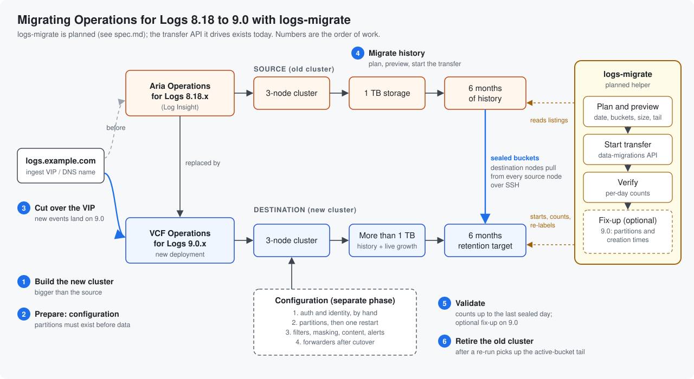

# Migration workflow

How a migration from Aria Operations for Logs 8.18 to VCF Operations for
Logs 9.0 is meant to run with `logs-migrate`.

**Status:** `logs-migrate` exists as an engine and CLI run against deterministic
fixtures; real appliance mutation is disabled pending lab qualification. See
[`operator-cli.md`](operator-cli.md) for the shipped commands and
[`spec.md`](spec.md) for the design. The transfer API underneath it, Broadcom's `/api/v2/data-migrations`, exists
today and has been tested (see
[`validation-2026-11-06-official-api.md`](validation-2026-11-06-official-api.md)).

The example has two 3-node clusters and six months of history on 1 TB. The
numbers in the diagram are the order of work.

## Steps

1. **Build the new cluster** next to the old one. 8.18 cannot be upgraded in
   place to 9.x ([`research-guide.md`](research-guide.md) section 1). Give it
   more storage than the source: it holds the migrated history plus live
   ingest from the cutover onward.
2. **Prepare: configuration.** This is a separate phase, not part of the
   tool. Follow the order in [`config-migration.md`](config-migration.md):
   - Auth and identity first, by hand. Those secrets cannot be exported.
   - Partitions next, then restart the new cluster once. Matching partitions
     have to exist before any data arrives.
   - Then filters, masking rules, content, datasets and roles, alerts, and
     agent groups by REST.
   - SMTP, the query forwarder, integrations, certificates and licenses are
     manual.
   - Forwarders wait until after step 3.

   Optionally, turn on NFS archiving on the old cluster. It only covers
   buckets sealed from then on, so it does not protect existing history.
3. **Cut over the VIP.** Point the ingest name (`logs.example.com` here) and
   any agents at the new cluster. New events now land on 9.0. Add the
   forwarders now.
4. **Migrate history.**
   - `logs-migrate plan` takes a date ("import back to this date"). It shows
     the buckets that reaches, their size and event counts, and the last
     fully sealed day.
   - The tool then starts Broadcom's transfer, which takes any time window.
     The 90-day limit is only in the UI.
   - The destination nodes pull sealed buckets straight from every source
     node over SSH. The data never passes through the machine running the
     tool.
5. **Validate.** `logs-migrate verify` compares per-day event counts up to
   the last fully sealed day. On 9.0 you can then run the optional fix-up:
   - It puts buckets back in their source partitions and gives them their
     real creation times.
   - It stops one destination node at a time, for about a minute each.
6. **Retire the old cluster** once the active-bucket tail is handled (see
   below).

## Things to know

- **Active buckets stay behind, and after the cutover they never seal.**
  The transfer only copies sealed buckets, and a bucket seals only when it
  hits its size cap. Restarting 8.18 does not seal it. Once ingest has moved
  to the new cluster, the source's active buckets stop growing, so waiting
  and re-running the transfer will never collect them. On a quiet partition
  that tail can be days or weeks of events; in the lab it was two weeks.
  The tool never stops the source or copies active buckets. Ways to finish:
  - **Re-run the same window** after the buckets seal. On 9.0 this needs
    `plan --tail-of` and unchanged topology; on 9.1.1 it is blocked, and a
    later window must select no previously imported bucket
    ([`operator-cli.md`](operator-cli.md)).
  - **Leave the tail on the old cluster** and keep it read-only until that
    data ages out.
- **COMPLETED does not mean everything moved.** At 95% disk use a node
  stops copying, skips the rest, and still reports COMPLETED. Verify catches
  it; size the new cluster so it does not happen.
- **Every source node must answer on SSH port 22** from the new cluster's
  nodes, with the root password given to the transfer. Any cluster member
  works as the source address; the transfer finds the rest from that node's
  config.
- **Do not change the new cluster's node count between transfer runs.** The
  transfer only checks the node it assigns each bucket to, so a different
  node count can copy a bucket twice.
- **Wide buckets.** A bucket is selected when its time range overlaps the
  window. One stray old event can stretch a bucket's range, and the whole
  bucket comes along. The plan lists them.
- **9.1.1 destinations** are supported as a preview. Reading the code
  suggests the transfer routes each event through the partition filters
  there, so no fix-up is needed; this is not yet proven live, and a
  9.0-to-9.1 lab run is still owed. Matching partitions must exist first.
  On 9.1, retention runs from the import day, not the event date.

Details and evidence: [`spec.md`](spec.md) and
[`validation-2026-11-06-official-api.md`](validation-2026-11-06-official-api.md).
